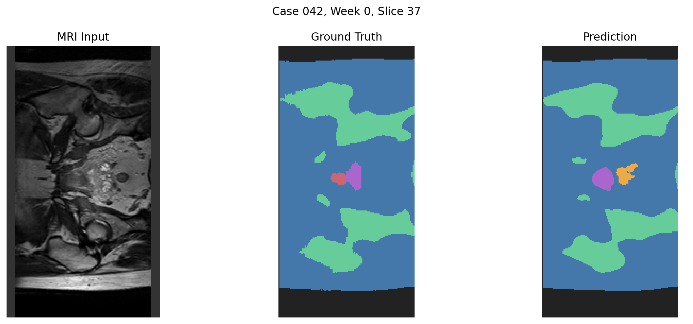
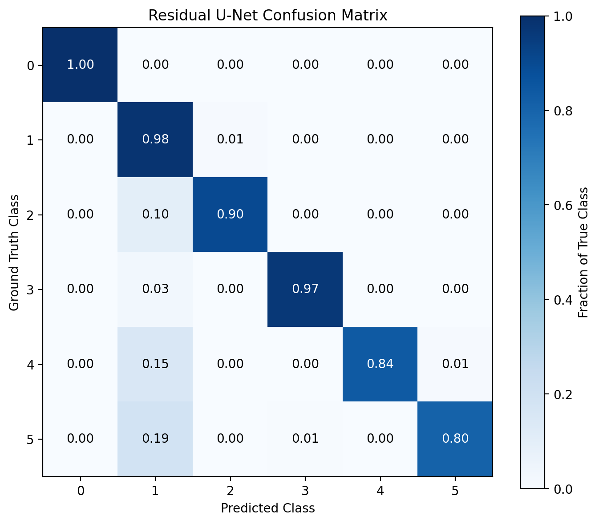
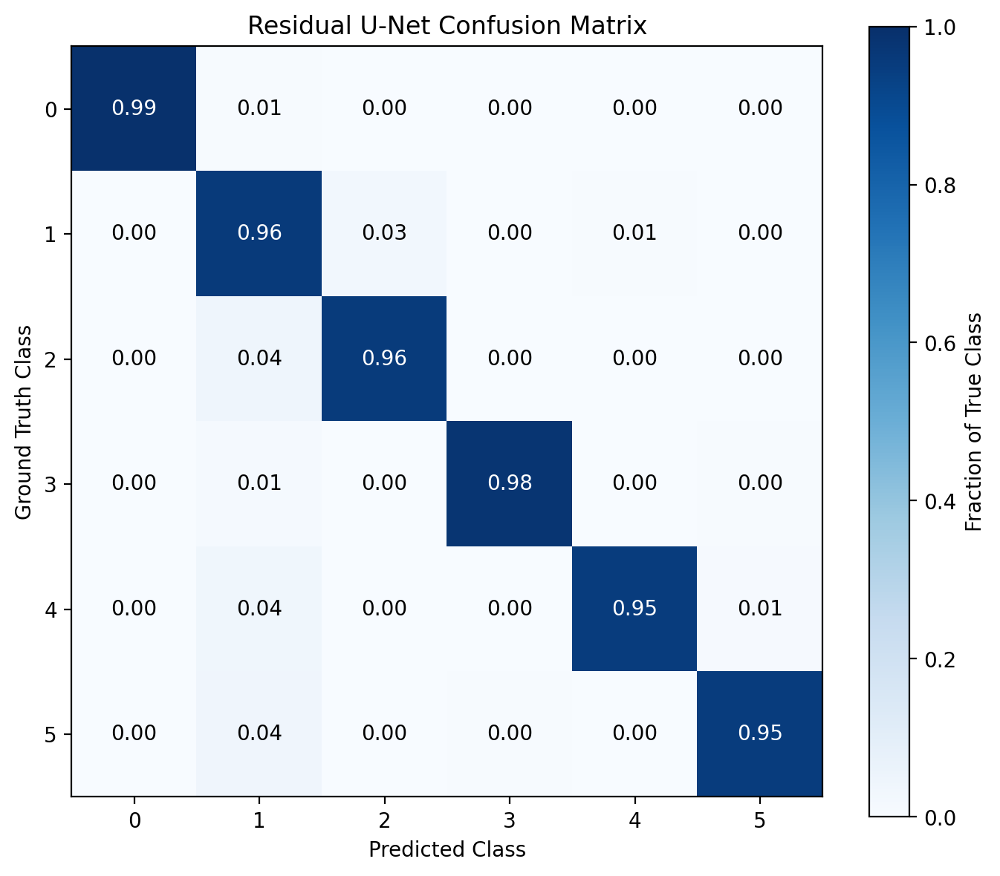
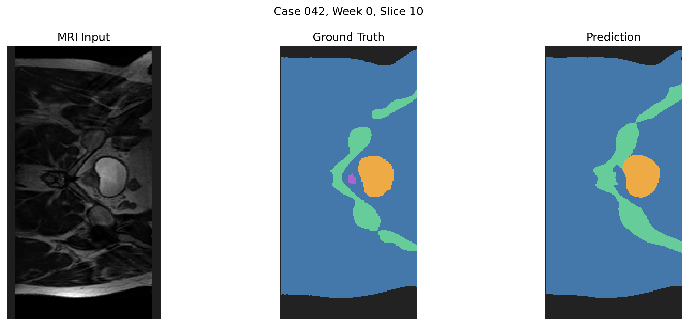
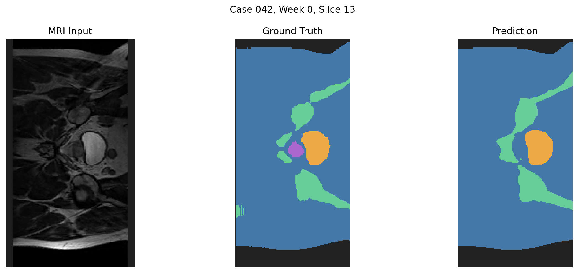

# Recognition Tasks - 2D Standard / Improved U-Net for Prostate MRI Segmentation

## Section 1 - Project Overview

### 1.1 Background and Motivation

Accurate anatomical segmentation of magnetic resonance imaging(MRI) is significant for medical image analysis and radiotherapy planning.Identifying anatomical structures and their boundaries can support clinical specialists in preparing and reviewing treatment plans. However, manual segmentation can be time-consuming, and automated approaches may struggle with small anatomical regions, ambiguous boundaries, and substantial differences in class frequency.

The HipMRI dataset provides annotated MRI slices for multi-class semantic segmentation.A major challenge is achieving reliable segmentation across different anatomical regions, particularly when less frequent classes occupy only a small proportion of the image. 

### 1.2 Project Objective

This project aims to investigate whether architectural improvements (e.g. loss function or algorithm structure) to a standard two-dimensional U-Net can improve MRI segmentation accuracy while maintaining reasonable computational efficiency.

A Standard 2D U-Net algorithm was implemented as the Baseline and would be compared against 3 architectural variants below:

* Attention U-Net:Introducing attention gates to encoder-decoder skip connection
* Residual U-Net:Replaces standard convolutional blocks with residual blocks.
* Residual Attention U-Net:Combining and implementing attention blocks and attention gates above.

An additional experiment evaluates Weighted CrossEntropyLoss to investigate the effect of class imbalance on segmentation performance.

All models would be evaluated and compared using per-class Dice Similarity Coefficient(DSC), Intersection-over-Union(IoU), qualitative segmentation visualisations, and computational resource measurements.

### 1.3 Engineering Research Question

The main research question of this report is:

**Could an improved 2D U-Net achieve a more accurate and reliable anatomical segmentation than a Standard 2D U-Net, particularly for small regions and difficult boundaries, without introducing excessive computational overhead?**

To investigate this question, this project compares segmentation accuracy and inference efficiency across the proposed models, examines class-specific errors, and analyses representative failure cases where global evaluation metrics may conceal local segmentation problems.

The resulting evidence is used to assess the suitability and limitations of the prototype as a clinical contour-review assistant rather than a fully autonomous segmentation system.

The picture above is used to visualize segmentation tasks and localized failures.It does not represents general performance of models in this project.

## Section 2 - Feasibility Check-off Report(Improved)
(This feasibility review summarises the original project scope and is updated with implementation and evaluation evidence obtained during subsequent development.)

### 2.1 User Need, Scope and Acceptance Criteria

This project investigates the an automated MRI segmentation assistant in order to support clinical imaging specialists in reviewing anatomical contours for radiotherapy planning.Manual contouring is time-consuming, while inaccurate boundaries may affect treatment planning and surrounding organs.The prototype aims to reduce manual segmentation effort while identifying limitations in segmentation accuracy, particularly for small anatomical regions and challenging slice boundaries.

The central engineering dilemma is whether an improved  2D U-Net can provide meaningful segmentation improvements over a standard 2D U-Net without introducing excessive computational cost.

The proposed prototype will be evaluated against the following criteria:

* Achieve a prostate Dice Similarity Coefficient (DSC) of at least 0.75 on the held-out test set.

* Compare the improved architecture against a standard 2D U-Net using per-class Dice and IoU, and evaluate challenging boundary regions.

* Investigate 3 - 5 representative segmentation failures and identify cases requiring manual review.

* Implement a reproducible six-class MRI segmentation pipeline with patient-independent training, validation and testing splits.

* Measure peak GPU memory usage and per-case inference time to evaluate computational feasibility.

### 2.2 Model Choice and Course Concepts

The project uses the HipMRI 2D dataset and a PyTorch implementation of U-Net. A standard 2D U-Net provides the baseline, while the improved architectures investigate residual connections and attention gates, individually and in combination.

Residual blocks introduce shortcut connections that facilitate gradient propagation. Attention gates adaptively modulate encoder features passed through skip connections. These techniques are evaluated to determine whether additional architectural complexity improves segmentation quality.

This project implements supervised learning, Convolutional Neural Network(CNN), encoder–decoder architectures, skip connections and gradient-based optimisation.CrossEntropyLoss is used for the initial experiments, with an additional class-weighted experiment investigating dataset imbalance.

### 2.3 Preliminary Feasibility Evidence

The HipMRI 2D dataset was successfully accessed and loaded in a local Python environment. The dataset contains 25,320 files across training, validation and testing directories, including 11,460 training MRI images and 11,460 corresponding segmentation files.

The initial implementation confirmed successful data loading, forward propagation, backpropagation and GPU execution. Subsequent experiments established a working standard U-Net baseline.

The completed evaluation provides additional feasibility evidence: the standard U-Net achieved a test Macro Dice of 0.9142, while the Residual U-Net achieved 0.9159. The Residual U-Net required approximately 2.86 ms of model-forward computation per image on an NVIDIA RTX 4060 Laptop GPU, with approximately 233 MiB of peak inference GPU memory.

These findings demonstrate that the proposed 2D segmentation pipeline is computationally feasible on the available hardware.

### 2.4 Risks, Computing Budget and Fallback

The primary risks are severe class imbalance, ambiguous anatomical boundaries, limited inter-slice information and overfitting. The training data audit found that Class 1 represented approximately 67.51% of valid pixels, whereas Classes 4 and 5 together represented less than 1%.

The implementation uses a GPU with 8 GB of dedicated memory, a batch size of 6, a maximum of 30 training epochs and early stopping to limit unnecessary computation.

The planned investigation compares standard, residual and attention-based U-Net variants and examines whether loss weighting improves minority-class segmentation. If architectural modifications provide no meaningful improvement, the standard U-Net remains the fallback because of its competitive accuracy and lower computational complexity.

The prototype is intended as a research and contour-review assistant rather than an autonomous clinical system. Boundary failures and uncertain regions must be reviewed by qualified specialists before any clinical application.

## Section 3 Dataset and Preprocessing

### 3.1 Dataset Description

This project uses the HipMRI Study dataset, provided for the COMP3710 Pattern Recognition project. The dataset contains two-dimensional MRI slices stored in NIfTI (.nii.gz) format, with corresponding semantic segmentation masks.

Each MRI slice is paired with a ground-truth segmentation mask containing six integer class labels (0–5). The segmentation task requires the model to predict an anatomical class for every pixel in the input image.

The original MRI slices have a height of 256 pixels and varying widths, primarily 128 pixels, with a smaller number of slices having a width of 144 pixels. Images and segmentation masks are processed as corresponding pairs to preserve spatial alignment.

The segmentation masks contain six integer class labels, with anatomical definitions provided in the dataset's BriefDataDescription.txt file:

* Class 0 = Background
* Class 1 = Body
* Class 2 = Bones
* Class 3 = Bladder
* Class 4 = Rectum
* Class 5 = Prostate

These labels are used consistently across training, validation, and testing. In particular, Class 5 represents the prostate, which is the target anatomical structure for the project acceptance criterion of Test Dice ≥ 0.75.

### 3.2 Data Splitting

The dataset contains 12,660 paired MRI slices and segmentation masks, divided into training, validation, and testing subsets.

| Dataset | MRI Slices | Patients | Purpose |
|---|---|---|---|
| Training | 11460 | 31 | Model parameter optimisation |
| Validation |660 | 4 | Model selection and early stopping |
| Testing | 540 | 3 | Final evaluation on unseen patients |

Patient-level separation is maintained across the three subsets. All slices belonging to the same patient and are assigned to a single split to prevent patient-level data leakage(Instead of shuffling randomly).This is particularly important for MRI segmentation because slices from the same patient may share anatomical characteristics. Randomly splitting individual slices could allow the model to encounter highly related images during both training and testing, resulting in overly optimistic performance estimates.

The training dataset is used to update model parameters, the validation dataset is used to monitor generalisation and select checkpoints, and the testing dataset is reserved for final performance evaluation.

### 3.3 Data Preprocessing

The following preprocessing steps are applied consistently across the dataset.

**1. NIfTI Loading and Tensor Conversion**

MRI images and segmentation masks are loaded from their corresponding NIfTI files.

MRI intensities are converted to 32-bit floating-point tensors (float32), while segmentation masks are converted to 64-bit integer tensors (int64) for compatibility with PyTorch's CrossEntropyLoss.

**2.Intensity Normalisation**

Each MRI slice is independently normalised using Z-score normalisation:

I_norm = (I - mu) / (sigma + epsilon), where "I" is the original intensity, "mu" and "sigma" are the mean and standard deviation of the slice, and "epsilon" is a small constant used to avoid dividing by zero.

This reduces differences in intensity scale across MRI images while preserving their spatial structure.

**3.Spatial Padding**

Most of the MRI images are 256 * 128 but some of samples are 256 * 144.To support batch processing, all images and masks are padded to a common spatial size of 256 × 144 pixels since forcily changing those 256 * 144 to 256 * 128 would influence the learning result(i.e. it preserves the original labelled pixels without interpolating categorical segmentation masks), padding with zeros would be better.Segmentation masks are padded using the special label -100, which is excluded from the training loss and evaluation metrics.

**4.Mask Handling**

Segmentation masks retain their original integer class labels (0–5). During training, CrossEntropyLoss is configured with ignore_index=-100, ensuring that padded regions do not contribute to the optimisation objective.

The same exclusion is applied when calculating Dice and IoU, so padded pixels are not counted as segmentation predictions.

### 3.4 Class Distribution and Imbalance

The training dataset contains 375,767,040 valid labelled pixels. Class frequencies were calculated using the training segmentation masks only, excluding validation and test data.

|Class(Structure)|Pixel Count|Percentage|
|---|---|---|
|0(Background)|64897313|17.2706%|
|1(Body)|253682431|67.5106%|
|2(Bones)|46951538|12.4949%|
|3(Bladder)|7296009|1.9416%|
|4(Rectum)|1340454|0.3567%|
|5(Prostate)|1599295|0.4256%|

The distribution reveals substantial class imbalance. Class 1(Body) accounts for approximately 67.51% of all labelled pixels, whereas Classes 4(Rectum) and 5(Prostate) collectively account for less than 1%.

This imbalance is an important consideration because standard pixel-wise CrossEntropyLoss may be dominated by frequently occurring classes.

To investigate its influence, an additional experiment uses Weighted CrossEntropyLoss, with class weights calculated from the inverse square root of training-set class frequencies.

The impact of this weighting strategy is evaluated separately in the experimental results and discussion.

## Section 4 Methodology and Model Architectures

### 4.1 Baseline:Standard 2D U-Net

A standard 2D U-Net was implemented as the baseline model for six-class semantic segmentation of HipMRI slices in this project.

U-Net follows an encoder-decoder structure.The encoder progressively extracts increasingly abstract image features through convolutional blocks and downsampling, while the decoder restores spatial resolution to produce pixel-level segmentation predictions.

The main components are as below:

* Double Convolution Blocks: Two consecutive convolutional layers (encoder and decoder) with nonlinear activation functions for feature extraction.
* Downsampling: Max-pooling operations reduce spatial resolution and increase the receptive field.
* Upsampling: Decoder operations progressively restore the spatial dimensions of the feature maps.
* Skip Connections: Encoder feature maps are concatenated with corresponding decoder feature maps to recover spatial information that may be lost during downsampling.
* Output Layer: A final 1 × 1 convolution produces six class logits for each pixel.

For a batch of MRI slices with shape [B, 1, 256, 144], the model produces an output tensor with shape [B, 6, 256, 144]. The predicted segmentation mask is obtained by selecting the class with the highest logit at each pixel.

The baseline provides a reference for evaluating whether additional architectural mechanisms improve segmentation performance.

### 4.2 Attention 2D U-Net

The Attention U-Net introduces attention gates into the encoder–decoder skip connections.In a standard U-Net, encoder feature maps are directly connected with decoder features. However, not all encoder features are equally relevant to the target anatomical structures.

Attention gates use contextual information from the decoder to calculate spatial attention coefficients for encoder features. These coefficients modulate the skip-connection features before they are passed to the decoder.

The intended benefit is to emphasise relevant anatomical regions and reduce the contribution of less informative features.

This architecture is investigated to determine whether selective feature transmission improves segmentation of small structures and challenging boundaries.

### 4.3 Residual 2D U-Net

The Residual U-Net replaces standard convolutional feature-extraction blocks with residual blocks.

A residual block introduces a shortcut connection between its input and output, allowing the network to learn a residual mapping rather than relying entirely on a sequence of convolutional transformations.

The fundamental operation can be expressed as: Y = F(x) + S(x)

where (F(x)) represents the learned convolutional transformation and (S(x)) represents the shortcut connection, which may be an identity mapping or a projection when tensor dimensions differ.

Residual connections can improve gradient propagation and facilitate the training of deeper feature-extraction networks.

The Residual U-Net is evaluated to determine whether this modification improves feature representation and segmentation reliability compared with the standard baseline.

### 4.4 Residual Attention 2D U-Net

The Residual Attention U-Net combines residual feature-extraction blocks with attention-gated skip connections.

Residual blocks are used to support feature learning, while attention gates selectively modulate encoder features before their integration into the decoder.

Combining these mechanisms may provide complementary benefits: improved feature representation and more selective spatial information transfer.

However, the combination also introduces additional model complexity. The experiment therefore evaluates whether any improvement in segmentation accuracy justifies its computational overhead.

### 4.5 Loss Function

**Standard Cross-Entropy Loss**

The baseline and architectural comparison experiments are trained using pixel-wise CrossEntropyLoss.

For each valid pixel, the loss penalises the model when the predicted probability assigned to the ground-truth class is low.

The loss can be expressed as:

$$\mathcal{L}_{CE}=-\frac{1}{N}\sum_{i=1}^{N}\log(p_{i,y_i})$$

 where "N" is the number of valid pixels, "p(i,yi)" is is the predicted probability of the correct class for pixel "i", and padded pixels with the label -100 are excluded.

**Class-Weighted Cross-Entropy Loss**

The training dataset exhibits substantial class imbalance, with Body (Class 1) accounting for approximately 67.51% of all labelled pixels, while Rectum (Class 4) and Prostate (Class 5) together account for less than 1%.

An additional experiment uses a Residual U-Net with class-weighted CrossEntropyLoss to investigate whether increasing the contribution of infrequent classes improves their segmentation performance.

The class weights are calculated from training-set class frequencies using an inverse square-root weighting strategy:

$$\mathcal{L}_{WCE}=-\frac{\sum_{i=1}^{N} w_{y_i}\log(p_{i,y_i})}{\sum_{i=1}^{N} w_{y_i}}$$

 where $$w_{y_i}$$ is the weight corresponding to the pixel's true class.

The resulting weights for Classes 0–5 are approximately:[0.3159, 0.1598, 0.3714, 0.9422, 2.1982, 2.0125]

This strategy increases the relative contribution of rare classes without applying the more extreme scaling of direct inverse-frequency weighting.

The weighted-loss experiment retains the Residual U-Net architecture, allowing the effect of the loss function to be investigated separately from architectural changes.

### 4.6 Model Comparison Strategy

|Experiment|Architecture|Training Loss|
|---|---|---|
|1|Standard U-Net|Cross-Entropy|
|2|Attention U-Net|Cross-Entropy|
|3|Residual U-Net|Cross-Entropy|
|4|Residual Attention U-Net|Cross-Entropy|
|5|Residual U-Net|Class-Weighted Cross-Entropy|

All experiments use the same patient-level dataset splits and are assessed using class-wise Dice and IoU, macro-averaged segmentation performance, and computational efficiency.

The comparison focuses on whether architectural improvements or loss reweighting produce meaningful benefits for clinically relevant structures, particularly the Prostate (Class 5), while maintaining reasonable inference cost.

## Section 5 Experimental Setup

### 5.1 Hardware and Software Environment

All experiments were conducted locally using a Windows 11 laptop equipped with an NVIDIA GeForce RTX 4060 Laptop GPU with 8 GB of dedicated video memory.

The models were implemented using Python and PyTorch with CUDA acceleration. NumPy was used for numerical operations, NiBabel for loading NIfTI MRI images and segmentation masks, and Matplotlib for result visualisation.

The implementation was organised into separate modules for dataset handling, model architectures, training, and inference.

The exact software versions can be obtained from the experimental environment and should be recorded in the dependency specification to support reproducibility.

### 5.2 Training Configuration

All five experimental configurations used the same patient-independent training, validation, and test subsets.

The principal training hyperparameters were:

|**Hyperparameter**|**Value**|
|---|---|
|Optimizer|ADAM|
|Initial Learning Rate|0.0001|
|Batch Size|6|
|Maximum epochs|30|
|Early stopping patience|5 epochs|
|Early stopping minimum improvement|0.001|
|Random seed|42|
|Input channels|1|
|Output classes|6|
|Input dimensions|256 * 144|
|Ignore index for padding|-100|

Four architectural configurations were trained using standard CrossEntropyLoss. An additional Residual U-Net experiment used class-weighted CrossEntropyLoss.

The batch size was selected to fit the available GPU memory while allowing efficient mini-batch optimisation.

### 5.3 Training Procedure and Model Selection

During each training iteration, a mini-batch of MRI slices and ground-truth segmentation masks was loaded and passed through the network.

The resulting logits were compared with the ground-truth class labels using the selected loss function. Gradients were calculated by backpropagation, and the Adam optimizer updated the model parameters.

After each training epoch, validation was performed without gradient computation or parameter updates.

Validation loss was monitored for checkpoint selection and early stopping. The checkpoint with the lowest observed validation loss was retained as the selected model for final evaluation.

Training stopped when the maximum number of epochs was reached or when validation loss failed to improve sufficiently for five consecutive epochs.

The independent test set was used only for final evaluation, rather than for training updates or checkpoint selection.

### 5.4 Evaluation Metrics

Segmentation accuracy was evaluated using Dice Similarity Coefficient and Intersection over Union (IoU), computed separately for each of the six anatomical classes.

For a given class, true positives (TP) represent correctly predicted pixels, false positives (FP) represent pixels incorrectly assigned to that class, and false negatives (FN) represent pixels belonging to that class but predicted as another class.

* Dice Similarity Coefficient = 2 * TP[c] / (2 * TP[c] + FP[c] + FN[c])
* Intersection over Union(IoU) = TP[c] / (TP[c] + FP[c] + FN[c]) (where c = class 0~5)

Macro Dice is calculated by averaging the Dice scores across the six classes:(Dice[0] + Dice[1] + ... +Dice[5])/6

Padded pixels with the ignore label -100 were excluded from metric calculations.

Particular attention was given to Prostate (Class 5), because achieving a prostate test Dice score of at least 0.75 is an explicit project acceptance criterion.

In addition to quantitative metrics, predicted segmentation masks were compared visually with ground-truth masks to investigate localised segmentation failures and anatomical boundary errors.

### 5.5 Inference and Computational Efficiency

Computational efficiency was evaluated alongside segmentation accuracy.

The following measurements were considered:

* Model parameter count: the number of trainable model parameters, representing architectural complexity.
* Inference latency: The average GPU model-forward time per MRI slice during batched inference.
* Peak GPU memory usage: The maximum allocated GPU memory recorded during inference.

Inference measurements were performed using the same GPU environment to support comparisons between architectural configurations.

The benchmark results are presented in Part 6 alongside the corresponding segmentation metrics.

### 5.6 Reproducibility and Experimental Controls

To improve experimental reproducibility, the random seed was set to 42, and all configurations used the same patient-independent dataset partitions and image preprocessing procedure.

The principal training settings, including batch size, learning rate, optimizer, maximum epochs, and early stopping configuration, were kept consistent across experiments.

The architectural comparisons used the same standard CrossEntropyLoss so that observed differences could be examined in relation to the model modifications.

The weighted-loss experiment retained the Residual U-Net architecture and modified only the training loss configuration.

Because each configuration was evaluated in a limited number of training runs, differences in performance should be interpreted as experimental observations rather than statistically established improvements. Minor variation may occur between runs due to GPU execution and other sources of training randomness.

|Software/Module used|Version|
|---|---|
|Python|3.14.3|
|PyTorch|2.14.0+cu130|
|CUDA runtime|13.0|
|NumPy|2.4.3|
|NiBabel|5.4.2|
|Matplotlib|3.10.8|

## Section 6 Results and Benchmarking

### 6.1 Overall Segmentation Performance

Five experimental configurations were evaluated on the independent test dataset containing 540 MRI slices from three patients.

The overall segmentation performance is summarised below.

|Model|Macro Dice|Macro IoU|
|---|---|---|
|Standard 2D U-Net|0.9142|0.8505|
|Attention 2D U-Net|0.8875|0.8128|
|Residual 2D U-Net|0.9159|0.8527|
|Residual Attention 2D U-Net|0.9071|0.8403|
|Residual 2D U-Net + Weighted CE|0.8779|0.7995|

**Macro IoU values are approximated from the reported class-wise Dice scores using the Dice–IoU relationship and then averaged across the six classes.(raw trained data can be found in results folder)**

Residual U-Net achieved the highest Macro Dice of 0.9159, slightly exceeding the Standard U-Net baseline of 0.9142.

Attention U-Net and Residual Attention U-Net did not outperform the baseline in overall Dice. The weighted-loss experiment also produced a lower Macro Dice than the standard Residual U-Net.

These results indicate that architectural complexity does not necessarily translate into better segmentation accuracy. In this experiment, residual feature-extraction blocks provided a small improvement in overall segmentation performance, whereas the attention-based modifications did not demonstrate a consistent advantage.

### 6.2 Class-wise Segmentation Results

Class-wise Dice scores provide a more detailed assessment of segmentation performance across anatomical structures.

|Model|Background|Body|Bones|Bladder|Rectum|Prostate|
|---|---|---|---|---|---|---|
|Standard 2D U-Net|0.9964|0.9810|0.9193|0.9601|0.7983|0.8300|
|Attention 2D U-Net|0.9955|0.9780|0.9094|0.9494|0.7597|0.7330|
|Residual 2D U-Net|0.9964|0.9810|0.9183|0.9581|0.8123|0.8294|
|Residual Attention 2D U-Net|0.9964|0.9812|0.9202|0.9551|0.7946|0.7953|
|Residual 2D U-Net + Weighted CE|0.9956|0.9732|0.9005|0.9480|0.7201|0.7303|

Background and Body achieved consistently high Dice scores across all models.

In contrast, Rectum and Prostate showed lower segmentation accuracy, consistent with the challenges associated with small anatomical structures and class imbalance.

Residual U-Net achieved the highest Rectum Dice of 0.8123, while Standard U-Net achieved the highest Prostate Dice of 0.8300.

Although Residual Attention U-Net produced marginally higher Dice scores for Body and Bones, these improvements did not result in a higher overall Macro Dice.

### 6.3 Prostate Segmentation Performance

The project specification identifies a Prostate Test Dice score of at least 0.75 as an acceptance criterion.

The dataset annotation documentation confirms that Class 5 corresponds to the prostate.

|Model|Prostate Dice|Meets 0.75 Target|
|Standard 2D U-Net|0.8300|True|
|Attention 2D U-Net|0.7330|False|
|Residual 2D U-Net|0.8294|True|
|Residual Attention 2D U-Net|0.7953|True|
|Residual 2D U-Net + Weighted CE|0.7303|False|

Three of the five configurations satisfied the prostate segmentation threshold.

Standard U-Net achieved the highest Prostate Dice, narrowly exceeding Residual U-Net by 0.0006.

This distinction is important because the architecture with the highest overall Macro Dice was not the one with the highest Prostate Dice.

The results suggest that model selection should consider anatomical priorities in addition to aggregate segmentation metrics.

### 6.4 Computational Benchmarking

Computational efficiency was assessed using model parameter counts, GPU inference latency, and peak allocated GPU memory during inference.

The benchmark was conducted on an NVIDIA GeForce RTX 4060 Laptop GPU using the same test dataset.

|Model|Parameters|Inference Latency (ms/image)|Peak GPU Memory (MiB)|
|---|---|---:|:---:|
|Standard 2D U-Net|1962422|2.473|Approximately 209–215|
|Attention 2D U-Net|1995426|5.320|229.04|
|Residual 2D U-Net|2071974|2.860|232.82|
|Residual Attention 2D U-Net|2104978|3.132|246.05|
|Residual 2D U-Net + Weighted CE|2,071,974|5.914|232.82|

Inference latency represents GPU model-forward time per image during batched inference. Memory values represent peak allocated inference memory, not the peak memory used during training.

The Standard U-Net achieved the lowest measured inference latency among the five experiments.

Residual U-Net provided the highest overall Macro Dice while maintaining relatively low inference latency.

Residual Attention U-Net required more parameters and inference memory than Residual U-Net but did not achieve better Macro Dice or Prostate Dice.

The weighted-loss experiment used the same Residual U-Net architecture. Therefore, the difference in measured inference latency should not be interpreted as additional architectural complexity caused by the weighting strategy. Runtime variation and benchmark conditions may contribute to the observed difference.

### 6.5 Interpretation of Results

The experimental results suggest three main findings.

Residual connections provided a modest overall improvement.

Residual U-Net increased Macro Dice from 0.9142 to 0.9159 and improved Rectum Dice from 0.7983 to 0.8123 compared with the baseline.

However, its Prostate Dice remained approximately equal to that of Standard U-Net.

**Attention mechanisms did not consistently improve performance.**

Attention U-Net achieved lower overall and Prostate Dice than Standard U-Net. Combining residual and attention mechanisms also failed to outperform the standalone Residual U-Net.

This suggests that the additional attention mechanisms were not beneficial under the tested configuration and training conditions.

**Class-weighted loss did not improve the final Dice scores of minority anatomical classes.**

Although class-weighted CrossEntropyLoss was designed to increase the influence of rare classes, the weighted Residual U-Net produced lower Rectum and Prostate Dice than the standard Residual U-Net.

A possible explanation is a precision–recall trade-off, where stronger weighting increases sensitivity to minority classes but also increases false-positive predictions.

This hypothesis is examined further through confusion matrices and representative segmentation failure cases in Part 7.

Overall, the results favour relatively simple architectures over additional complexity. Residual U-Net achieved the highest overall Macro Dice, while Standard U-Net delivered slightly better Prostate Dice and lower measured inference latency.

## Section 7 Failure Case Analysis

### 7.1 Failure Analysis Method

Although the evaluated models achieved relatively high overall Dice scores, aggregate metrics may conceal substantial errors in individual MRI slices.

To investigate localised segmentation failures, predicted masks were compared against ground-truth annotations, with particular attention to Rectum (Class 4) and Prostate (Class 5).These anatomical structures occupy relatively small proportions of the training dataset and are therefore important targets for localised failure analysis.

The analysis considered three types of evidence:

* Ground-truth and predicted segmentation masks: To identify missing regions and incorrect anatomical assignments.

* Class-wise Dice scores: To quantify the overlap between predicted and annotated regions.

* Confusion matrices: To distinguish false-positive and false-negative errors across anatomical classes.

The selected examples illustrate different failure patterns, including confusion between adjacent structures, complete omission of Prostate regions, and increased false-positive predictions under class-weighted training.
### 7.2 Failure Case 1: Missing Rectum Segmentation

A representative failure was observed in Patient 042, Week 0, Slice 37.

The ground-truth mask contained 136 pixels belonging to Rectum (Class 4). However, the Residual U-Net failed to assign any of these pixels to the correct class.

Instead:

128 Rectum pixels were predicted as Prostate (Class 5).

8 Rectum pixels were predicted as Body (Class 1).

No Rectum pixels were correctly identified.

As a result, the Rectum Dice score for this slice was 0.

*(MRI input, ground-truth segmentation, and class-weighted Residual U-Net prediction for Case 042, Week 0, Slice 37. The small Rectum region is missing from the prediction, demonstrating confusion between neighbouring anatomical structures.)*

This example demonstrates a complete local failure despite the model achieving an overall test-set Rectum Dice of 0.8123.

The error is especially relevant because Rectum and Prostate are distinct anatomical structures that may appear in nearby regions of pelvic MRI images.

The result suggests that the model had difficulty distinguishing the local anatomical features associated with these structures in this particular slice.

### 7.3 Failure Case 2: Differences Between Model Predictions

To investigate whether architectural modifications resolved the Rectum segmentation failure, the predictions from all five experimental configurations were compared for Case 042, Week 0, Slice 37.

|Model|Classification of the 136 Ground-Truth Rectum Pixels|
|---|---|
|Standard U-Net|136 predicted as Prostate|
|Attention U-Net|129 predicted as Body; 7 as Prostate|
|Residual U-Net|8 predicted as Body; 128 as Prostate|
|Residual Attention U-Net|136 predicted as Prostate|
|Residual U-Net + Weighted CE|136 predicted as Prostate|

None of the five models correctly identified any of the 136 Rectum pixels in this slice.

However, their error distributions differed. Most configurations assigned the Rectum region to Prostate, whereas Attention U-Net primarily assigned it to Body.

This finding indicates that modifying the network architecture changed the predictions but did not eliminate the local failure.

The case also demonstrates a limitation of using overall model performance as the only selection criterion. Different architectures may produce similar aggregate results while making different errors in individual anatomical regions.

### 7.4 Failure Case 3: False Positives Under Weighted Cross-Entropy

An additional failure pattern was observed when class-weighted CrossEntropyLoss was applied to Residual U-Net.

The weighting strategy was intended to increase the contribution of infrequent classes during training. However, the weighted model achieved lower Dice scores for both Rectum and Prostate.

|Anatomical Structure|Residual U-Net|Residual U-Net + Weighted CE|
|---|---|---|
|Rectum|0.8123|0.7201|
|Prostate|0.8294|0.7303|

The test-set confusion matrices revealed substantial increases in Body pixels incorrectly assigned to these minority classes.

|Misclassification|Residual U-Net|Residual U-Net + Weighted CE|
|---|---|---|
|Body → Rectum|22677|69364|
|Body → Prostate|6817|36285|

These results show that the weighted model produced more false-positive predictions for minority anatomical structures.

Although stronger class weighting can increase sensitivity to rare classes, it may also cause the model to assign those labels to regions belonging to other structures.

The observed reduction in Dice is consistent with a precision–recall trade-off: reducing some false negatives does not necessarily improve overall overlap when false positives increase substantially.

The corresponding confusion matrices were generated and saved as:

*(Residual 2D U-Net Confusion Matrix)*

*(Residual 2D U-Net + Class-Weighted Cross-Entropy Matrix)*
The matrices provide complementary evidence for changes in the distribution of segmentation errors. Because the visualisations are row-normalised, the absolute pixel counts in the table above should be used when comparing the number of misclassified pixels.

### 7.5 Failure Case 4: Complete Prostate Omission

Further failures were identified in Case 042, Week 0, Slices 10 and 13, using the Residual U-Net trained with class-weighted Cross-Entropy.

These examples are particularly relevant because Prostate (Class 5) is the primary anatomical target specified in the project acceptance criteria.

**Slice 10: Missing a small Prostate region**

The ground-truth segmentation contained 55 Prostate pixels, but the model predicted no pixels belonging to Class 5.

Therefore, the slice-wise Prostate Dice score was 0.

*(Complete omission of the Prostate region in Case 042, Week 0, Slice 10. The ground-truth Prostate region is visible, but the weighted Residual U-Net predicts no Prostate pixels.)*

**Slice 13: Missing a larger Prostate region**

A similar failure occurred in Slice 13, where the ground-truth mask contained 224 Prostate pixels.

Despite the larger target region, the model again predicted no Prostate pixels, producing a slice-wise Dice score of 0.

*(Complete omission of the Prostate region in Case 042, Week 0, Slice 13. The model fails to identify a larger annotated Prostate region, demonstrating that complete omissions are not limited to the smallest targets.)*

These failures suggest that class-weighted training did not consistently improve the reliability of Prostate segmentation across individual MRI slices.

Although both examples come from the same patient and adjacent slices, their repeated occurrence provides evidence of a localised failure pattern rather than an isolated prediction error.

The observations also demonstrate why whole-test-set Prostate Dice alone is insufficient for assessing segmentation reliability. A model can achieve a relatively high aggregate Dice score while completely missing the target structure in specific slices.

### 7.6 Implications for Clinical Boundary Utility

The failure analysis highlights an important distinction between aggregate segmentation accuracy and reliable anatomical delineation.

Three principal limitations were identified:

Anatomical confusion: Small neighbouring structures, particularly Rectum and Prostate, may be incorrectly assigned to one another.

Complete target omission: The model may fail to predict any Prostate pixels even when the ground-truth mask contains a clearly defined region.

False-positive expansion: Class-weighted training may increase the number of pixels incorrectly assigned to minority structures, reducing segmentation overlap.

These findings are relevant to MRI-based radiotherapy planning, where segmentation quality depends not only on average overlap but also on the accuracy of individual anatomical boundaries.

Neither architectural modifications nor class-weighted Cross-Entropy consistently eliminated the observed failures.

Therefore, the evaluated models should be considered experimental segmentation tools rather than independently reliable clinical systems. Any potential clinical application would require expert review, additional validation, and appropriate safety assessment.

Potential future improvements include boundary-aware loss functions, additional spatial context from neighbouring MRI slices, and anatomical consistency constraints. These approaches may help address localised failures but were not evaluated in the current experiments.

## Section 8 Discussion and Engineering Recommendation

### 8.1 Summary of Experimental Findings

This project investigated whether architectural modifications to a standard 2D U-Net could improve multi-class HipMRI segmentation while maintaining reasonable computational efficiency.

Five experimental configurations were evaluated using the same patient-independent dataset splits.

The main findings were:

* Residual U-Net achieved the highest overall Macro Dice (0.9159), slightly outperforming Standard U-Net (0.9142).

* Standard U-Net achieved the highest Prostate Dice (0.8300), marginally exceeding Residual U-Net (0.8294).

* Residual U-Net achieved the highest Rectum Dice (0.8123), compared with 0.7983 for Standard U-Net.

* Attention U-Net and Residual Attention U-Net did not outperform the baseline in overall Macro Dice.

* Class-weighted Cross-Entropy did not improve Rectum or Prostate Dice and produced additional false-positive predictions for minority anatomical structures.

The improvements associated with residual connections were relatively small. Therefore, the results do not provide sufficient evidence that architectural complexity consistently improves segmentation reliability.

### 8.2 Accuracy–Efficiency Trade-off

Model selection must consider both segmentation accuracy and computational cost.

Standard U-Net achieved a Macro Dice of 0.9142 and a Prostate Dice of 0.8300, with a measured inference latency of approximately 2.473 ms per image.

Residual U-Net achieved a slightly higher Macro Dice of 0.9159 but required approximately 2.860 ms per image during the recorded benchmark.

The difference in Macro Dice was only 0.0017, while the Standard U-Net provided marginally better Prostate segmentation accuracy and lower measured inference latency.

Residual Attention U-Net introduced additional architectural complexity without improving overall segmentation accuracy compared with either the baseline or the standalone Residual U-Net.

These findings suggest that increased model complexity should be justified by measurable improvements in clinically relevant outcomes rather than assumed to be beneficial.

### 8.3 Spatial Context and Clinical Boundary Reliability

A central challenge of this project is balancing computational efficiency against the spatial context required for reliable anatomical segmentation.

The evaluated models operate on individual two-dimensional MRI slices. Although encoder–decoder features and skip connections provide spatial information within each image, the models do not explicitly incorporate anatomical continuity between neighbouring slices.

The failure analysis identified several cases in which small anatomical structures were incorrectly segmented or completely omitted.

For example, in Case 042, Week 0, Slice 37, all 136 ground-truth Rectum pixels were misclassified by the standard Residual U-Net.

Further examples from Case 042, Slices 10 and 13, showed complete omission of Prostate regions by the class-weighted Residual U-Net, resulting in slice-wise Dice scores of 0.

These results demonstrate that satisfactory whole-test-set Dice scores do not guarantee reliable segmentation of individual slices.

Consequently, improving aggregate overlap alone is insufficient to establish clinical boundary reliability.

### 8.4 Engineering Recommendation

Standard 2D U-Net is recommended as the preferred baseline for further development and validation.

This recommendation is based on three considerations:

* Prostate segmentation accuracy: Standard U-Net achieved the highest observed Prostate Dice of 0.8300 and satisfied the required threshold of 0.75.

* Computational efficiency: It achieved the lowest measured inference latency among the five experimental configurations.

* Architectural simplicity: It avoided additional attention and residual mechanisms that did not demonstrate substantial improvement for the primary anatomical target.

Residual U-Net remains a reasonable alternative when higher overall Macro Dice or improved Rectum Dice is prioritised.

However, neither model should be considered ready for autonomous clinical deployment. The observed localised errors require further validation and expert review before any clinical application.

### 8.5 Limitations and Future Improvements

Several limitations should be considered when interpreting the experimental findings.

**Limited independent test population**

The test set contains 540 MRI slices from only three patients. Although patient-level separation prevents data leakage between dataset partitions, the small number of test patients limits confidence in generalisation to broader clinical populations.

**Single-run experimental comparisons**

Each configuration was evaluated using a limited number of training runs. Small differences, such as the 0.0017 Macro Dice improvement of Residual U-Net over Standard U-Net, may be influenced by training variability.

**Limited inter-slice spatial context**

The 2D models process individual MRI slices independently and do not explicitly model three-dimensional anatomical continuity.

**Sensitivity to small anatomical structures**

Rectum and Prostate occupy relatively small proportions of the labelled data. The failure cases demonstrate that these structures remain difficult to segment consistently, even when class weighting is introduced.

Potential future improvements include:

* 2.5D segmentation: Incorporating neighbouring MRI slices as additional input channels to provide inter-slice context while retaining a primarily two-dimensional architecture.

* Boundary-aware objectives: Investigating Dice-based or boundary-sensitive losses to improve local contour accuracy.

* Additional validation: Evaluating performance across more patients and repeated training runs to assess robustness.

* Anatomical consistency checks: Identifying implausible segmentation predictions and discontinuities between neighbouring slices.

These improvements are proposed as future research directions and were not implemented or evaluated in the present study.

### 8.6 Final Conclusion

This project demonstrated that 2D U-Net architectures can achieve strong overall segmentation performance on the HipMRI dataset while operating within the computational constraints of a consumer laptop GPU.

Residual U-Net produced the highest observed Macro Dice, but Standard U-Net achieved slightly better Prostate Dice and lower inference latency.

Attention mechanisms and class-weighted Cross-Entropy did not consistently improve the evaluated outcomes.

The failure analysis further showed that high aggregate Dice scores may conceal complete segmentation failures in individual slices, particularly for small anatomical structures.

Overall, the results support using Standard U-Net as an efficient starting point for further development, with future work focusing on spatial context, boundary reliability, and stronger patient-level validation rather than architectural complexity alone.

## Section 9 Installation and Usage Instructions

### 9.1 Execution Environment

**All model training and evaluation experiments in this project were conducted locally on a Windows 11 laptop, using an NVIDIA GeForce RTX 4060 Laptop GPU with 8 GB of dedicated video memory.**

PyTorch was used for model implementation and training, with CUDA acceleration when available.

The UQ Rangpur computing environment was used for access to and inspection of the supplied HipMRI dataset. The reported training and inference benchmarks were obtained from the local laptop rather than the Rangpur cluster.

### 9.2 Project Structure

The main Python files are organised as follows:

**Improved_UNet_49841510/**
* modules.py
* dataset.py
* train.py
* predict.py
* README.md
* **checkpoints/** *(Generated locally, not visible on GitHub)*
* **results/** *(Generated Locally)*
       **visualizations/**

* modules.py: Defines Standard U-Net, Attention U-Net, Residual U-Net, and Residual Attention U-Net.

* dataset.py: Loads paired MRI and segmentation masks, applies per-slice Z-score normalisation, and pads them to a consistent spatial size.

* train.py: Trains the selected architecture, performs validation, applies early stopping, and saves the best checkpoint and training history.

* predict.py: Loads a trained checkpoint and evaluates segmentation performance on the independent test set. Additional local analysis functionality is described in Section 9.6.

The checkpoints/ and results/ directories are generated or populated during local execution. Trained checkpoints and the original HipMRI dataset are not required to be committed to the repository.

### 9.3 Dependencies

The project uses Python with the following principal dependencies:

* PyTorch
* NumPy
* NiBabel
* Matplotlib

A CUDA-compatible PyTorch installation is recommended for GPU acceleration. The scripts can select the CPU when CUDA is unavailable, although execution may be substantially slower.

Install the required libraries in a suitable Python environment:
    python -m pip install numpy nibabel matplotlib

PyTorch should be installed using a build compatible with the available GPU and CUDA environment, following the official PyTorch installation instructions.

For reproducibility, the exact versions of Python, PyTorch, NumPy, NiBabel, and Matplotlib used in the experiments should be recorded alongside the final submission.

### 9.4 Dataset Preparation

The HipMRI dataset must be obtained through the authorised course or dataset distribution channels and **stored outside the Git repository.**

The scripts expect the following subdirectories under the configured dataset root:

**keras_slices_data/**
* keras_slices_train/
* keras_slices_seg_train/
* keras_slices_validate/
* keras_slices_seg_validate/
* keras_slices_test/
* keras_slices_seg_test/

MRI images and corresponding masks must retain their original file naming conventions, such as:

case_004_week_0_slice_0.nii.gz
seg_004_week_0_slice_0.nii.gz

Before running training or evaluation, manually update `DATA_ROOT` in both train.py and predict.py to the location of keras_slices_data on the local computer.
For example: 
**DATA_ROOT = Path(r"D:\path\to\keras_slices_data")**

The default dataset loader performs image–mask pairing, Z-score normalisation, tensor conversion, and symmetric spatial padding to 256 × 144. Segmentation padding is assigned the ignore label -100.

### 9.5 Model Training

Training is performed by running: python `train.py`

The current implementation uses configuration variables defined directly near the beginning of train.py, rather than command-line arguments.

Before starting an experiment, manually check:

|Configuration|Description|Experimental Setting|
|---|---|---|
|MODEL_TYPE|Selects model architecture|"baseline"/"attention"/"residual"/"residual_attention"|
|LOSS_TYPE|Selects training loss|"ce"/"weighted_ce"|
|DATA_ROOT|Local dataset directory|Proper path to the local HipMRI dataset|
|BATCH_SIZE|Training batch size|6|
|LEARNING_RATE|Adam learning rate|0.0001|
|NUM_EPOCHS|Maximum training epochs|30|
|PATIENCE|Early stopping patience|5|
|MIN_DELTA|Minimum validation-loss improvement|0.001|

Supported model names are: MODEL_TYPE = "baseline"/"attention"/"residual"/"residual_attention"("/" = or, select one of valid option)
*(Only one MODEL_TYPE assignment should be active at a time.)*

For the architectural comparisons, use: DATA_ROOT = "ce"

For the additional class-weighted experiment, use : MODEL_TYPE = "residual"  LOSS_TYPE = "weighted_ce"

The weighted-loss experiment uses the same Residual U-Net architecture and changes the CrossEntropyLoss class weights.

**Important: Full Training vs. Debugging Mode**

The training loop contains an optional debugging limit:
   `if batch_idx >= MAX_BATCHES:`
      `break`
**These lines must remain commented out for the full-dataset experiments reported in this README.**

If uncommented, the break statement limits the number of training batches processed in each epoch. This may be useful for checking whether the training pipeline executes correctly, but it does not reproduce the full training experiments.

For the reported experiments, all 11,460 training slices are available to be processed in each full epoch, subject to the early stopping configuration.

**Checkpoint and Training History**

The training script saves the best model checkpoint based on validation loss and records training history in CSV format.

The current checkpoint naming pattern in train.py is: best_{MODEL_TYPE}_{LOSS_TYPE}_unet_full.pth

Before reproducing the experiments, verify that the selected checkpoint filename does not overwrite a previously saved experiment.

### 9.6 Model Evaluation and Prediction

After training, evaluate a saved checkpoint using: python predict.py

The current implementation requires manual configuration of:

* MODEL_TYPE: Selects the architecture to instantiate.
* LOSS_TYPE: Distinguishes standard and weighted-loss experiments when selecting the corresponding checkpoint.
* DATA_ROOT: Identifies the local HipMRI dataset.
* CHECKPOINT_PATH: Identifies the saved trained model.

The model architecture must match the checkpoint used during training.

The evaluation script calculates class-wise Dice and IoU, patient-level metrics, a confusion matrix, and GPU inference measurements.

The locally extended version of predict.py also provides additional failure-case analysis, including:

* Slice-wise Dice calculations and ranking.
* Selection of low-performing Rectum or Prostate slices.
* MRI, ground-truth, and prediction visualisations.
* Export of per-slice performance records to CSV.

These additional analysis changes were initially developed locally and should be synchronised with the submitted repository version before they are described as directly reproducible from the final repository.

The visualisation output is saved under: results/visualizations/

The locally extended script also uses TARGET_CLASS to choose the anatomical structure for failure-case ranking, where Class 4 represents Rectum and Class 5 represents Prostate.

**Checkpoint Naming Consideration**

The current predict.py references specific checkpoint filenames that may differ from the generic naming convention used by train.py. Users must verify that CHECKPOINT_PATH points to the correct existing checkpoint before evaluation.

### 9.7 Reproducibility and Data Availability

The experiments used a fixed random seed of 42 and the same patient-independent dataset partitions across the five model configurations.

To reproduce the results, users should preserve the original data splits, use the specified preprocessing pipeline, select the appropriate architecture and loss function, and train on the complete training set.

The supplied HipMRI data are subject to the dataset's usage agreement, including restrictions on commercial use and requirements for acknowledgement and citation.

The original medical imaging dataset and trained model checkpoint files are not included in the Git repository. Access to the dataset must be obtained independently through authorised channels.

Reported metrics reflect the experiments completed on the specified local hardware and software environment. Exact replication of results may be affected by software versions, CUDA implementation details, and training randomness.

## Section 10 AI Usage Declaration

Generative artificial intelligence tools, primarily OpenAI ChatGPT, were used as supplementary learning and development assistance during this project.

### 10.1 Purpose and Scope of AI Assistance

AI assistance was used in the following areas:

Conceptual understanding: Explaining the principles of U-Net architectures, attention gates, residual connections, semantic segmentation, cross-entropy loss, class imbalance, and evaluation metrics.

Implementation guidance: Assisting with debugging, identifying potential implementation errors, and suggesting approaches for organising the dataset pipeline, model training, evaluation, and visualisation.

Experimental analysis: Helping interpret Dice and IoU results, confusion matrices, inference measurements, and representative segmentation failures.

Documentation support: Assisting with the structure, wording, and technical presentation of the README report.

AI-generated suggestions were used as supporting material rather than as an authoritative source of experimental evidence.

### 10.2 Human Contributions and Verification

The project involved the implementation, configuration, execution, and evaluation of the segmentation experiments using the supplied HipMRI dataset.

Model architectures, training procedures, dataset preprocessing, and evaluation outputs were examined through local execution and debugging.

The experimental results reported in this README were obtained from the actual model runs rather than generated or estimated by AI.

AI-assisted explanations and documentation were reviewed against the implemented code, dataset descriptions, and recorded experiment results.

Where inconsistencies or uncertainties were identified, the relevant code, outputs, or source documentation were checked before conclusions were incorporated into the report.

### 10.3 Limitations and Responsibility

Generative AI may produce inaccurate explanations, code suggestions, or interpretations. Therefore, AI-generated content was not treated as a substitute for empirical testing or independent verification.

In particular, the anatomical class mapping was confirmed using the dataset's BriefDataDescription.txt rather than inferred from AI interpretation of MRI images.

The author remains responsible for the correctness of the submitted implementation, experimental results, analysis, citations, and final report.

## Section 11 References and Acknowledgments

### 11.1 References

[1] Dowling, J. A., et al. (2015). Automatic Substitute Computed Tomography Generation and Contouring for Magnetic Resonance Imaging (MRI)-Alone External Beam Radiation Therapy From Standard MRI Sequences. International Journal of Radiation Oncology, Biology, Physics, 93(5), 1144–1153. https://doi.org/10.1016/j.ijrobp.2015.08.045

[2] Ronneberger, O., Fischer, P., and Brox, T. (2015). U-Net: Convolutional Networks for Biomedical Image Segmentation. Medical Image Computing and Computer-Assisted Intervention (MICCAI), 234–241. https://doi.org/10.1007/978-3-319-24574-4_28

[3] Oktay, O., et al. (2018). Attention U-Net: Learning Where to Look for the Pancreas. arXiv:1804.03999. https://arxiv.org/abs/1804.03999

[4] He, K., Zhang, X., Ren, S., and Sun, J. (2016). Deep Residual Learning for Image Recognition. Proceedings of the IEEE Conference on Computer Vision and Pattern Recognition (CVPR), 770–778. https://doi.org/10.1109/CVPR.2016.90

[5] PyTorch Contributors. PyTorch Documentation. https://docs.pytorch.org/docs/stable/

[6] NiBabel Developers. NiBabel Documentation. https://nipy.org/nibabel/

### 11.2 Dataset Acknowledgments

Data were provided in part by the HipMRI Study.

The HipMRI dataset was made available for research purposes and was used in this project for multi-class anatomical segmentation experiments.

The dataset originates from a retrospective MRI-alone radiotherapy study conducted at Calvary Mater Newcastle Hospital, as described by Dowling et al. (2015).

The original dataset's usage conditions, including restrictions on commercial use, participant re-identification, and redistribution, are acknowledged.

### 11.3 Academic Context

This project was completed as part of COMP3710 — Pattern Analysis and Recognition at The University of Queensland.

The implementation and evaluation were conducted for educational and research purposes. The segmentation models and results are not intended for clinical diagnosis or autonomous treatment planning.
